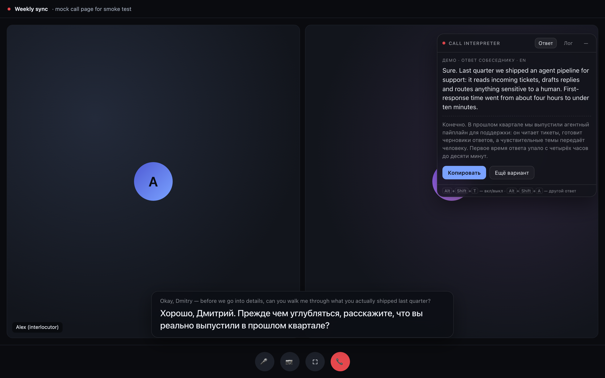
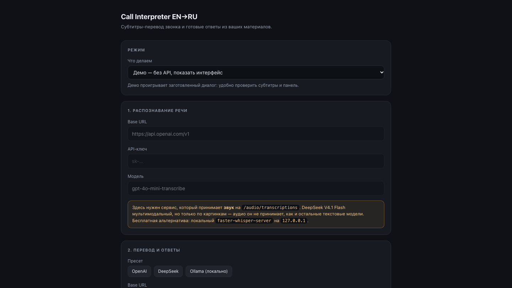

# Call Interpreter EN→RU

Расширение Chrome для звонков в браузере: слушает звук вкладки, показывает **субтитры с переводом** на русский и подсказывает **готовый ответ на английском**, собранный из ваших материалов.

*Subtitle translation and reply suggestions for browser calls. Captures tab audio, transcribes it (locally with whisper.cpp or via API), translates to Russian, and drafts an English reply from a brief you provide.*



## Зачем

Вы русскоязычный специалист на звонке с англоязычным собеседником. Нужно одновременно понимать, что говорят, и отвечать — без пауз и «извините, повторите».

Расширение не заменяет ваш голос: оно **читает** за собеседником и **подсказывает** текст ответа, который вы произносите сами. Работает поверх любого веб-звонка — Google Meet, Zoom Web, Teams Web, WhatsApp Web, Telegram Web.

## Что умеет

- **Субтитры в реальном времени.** Оригинал мелко сверху, перевод крупно снизу. Панель перетаскивается, прячется после 12 секунд тишины.
- **Подсказка ответа.** Когда собеседник задаёт вопрос, справа появляется ответ от первого лица на английском — 1–3 фразы, которые можно прочитать вслух. Ниже тот же ответ по-русски.
- **Отвечает только по вашим материалам.** В промпте жёсткое правило: нет факта — сказать «уточню», а не выдумывать.
- **Лог разговора** с переводом — вторая вкладка панели.
- **Демо-режим** без ключей: проигрывает заготовленный диалог, чтобы посмотреть интерфейс.
- **Локальное распознавание** через whisper.cpp — аудио не покидает ноутбук.

## Требования

- Google Chrome 116 или новее (нужны Offscreen API и `runtime.getContexts`).
- Для облачного варианта — API-ключ OpenAI (распознавание) и DeepSeek (перевод).
- Для локального — `whisper-server` в `PATH`: Homebrew на macOS, сборка на Linux, готовый архив на Windows. ~2 ГБ на модель.
- Node.js 18+ — только для запуска тестов, для самого расширения не нужен.

## Установка расширения

1. Скачайте репозиторий: `git clone <url> && cd web_live_translater`
2. Откройте `chrome://extensions`
3. Включите **Режим разработчика**
4. **Загрузить распакованное расширение** → выберите папку с репозиторием
5. Нажмите на иконку расширения → **Настройки**

## Запуск по платформам

Сам Chrome и загрузка расширения одинаковы на всех ОС. Ниже — что установить до этого и как поднять локальное распознавание. Для облачного варианта (B) достаточно Chrome; Node.js нужен только для тестов.

### macOS

```bash
brew install whisper.cpp
mkdir -p ~/whisper-models
curl -L -o ~/whisper-models/ggml-large-v3-turbo.bin \
  https://huggingface.co/ggerganov/whisper.cpp/resolve/main/ggml-large-v3-turbo.bin
```

Запуск сервера:

```bash
./scripts/start-whisper.sh
```

Для тестов Chrome обычно находится автоматически. Если он установлен не в `/Applications`:

```bash
export CHROME_PATH="/Applications/Google Chrome.app/Contents/MacOS/Google Chrome"
```

### Linux

Зависимости для сборки:

```bash
sudo apt update
sudo apt install -y git cmake build-essential
```

Сборка `whisper-server` и установка в `PATH`:

```bash
git clone https://github.com/ggml-org/whisper.cpp
cd whisper.cpp
cmake -B build
cmake --build build --config Release -j"$(nproc)"
sudo install -m 755 build/bin/whisper-server /usr/local/bin/
cd ..
```

Модель и запуск:

```bash
mkdir -p ~/whisper-models
curl -L -o ~/whisper-models/ggml-large-v3-turbo.bin \
  https://huggingface.co/ggerganov/whisper.cpp/resolve/main/ggml-large-v3-turbo.bin

chmod +x scripts/start-whisper.sh
./scripts/start-whisper.sh
```

Если используете дистрибутив с Homebrew (Linuxbrew), вместо сборки подойдёт `brew install whisper.cpp`. Можно также взять готовый `whisper-bin-ubuntu-x64.tar.gz` из [релизов](https://github.com/ggml-org/whisper.cpp/releases), если версия glibc подходит.

Путь к Chrome для тестов:

```bash
export CHROME_PATH="$(command -v google-chrome || command -v chromium || command -v chromium-browser)"
```

### Windows

1. Установите Chrome 116+, при необходимости — Node.js 18+ с [nodejs.org](https://nodejs.org).
2. Откройте [релизы whisper.cpp](https://github.com/ggml-org/whisper.cpp/releases) и скачайте `whisper-bin-x64.zip` из свежего билда (тег вида `bXXXX`; у версий `vX.Y.Z` готовых архивов может не быть).
3. Распакуйте архив, например в `C:\whisper.cpp`. Внутри будет папка `Release` с `whisper-server.exe` и DLL рядом с ним.
4. Добавьте `C:\whisper.cpp\Release` в `PATH`: **Параметры → Система → О системе → Дополнительные параметры системы → Переменные среды → Path → Создать**. Перезапустите терминал и проверьте `whisper-server.exe --help`.

Скачайте модель и запустите сервер в PowerShell:

```powershell
New-Item -ItemType Directory -Force "$env:USERPROFILE\whisper-models" | Out-Null
curl.exe -L -o "$env:USERPROFILE\whisper-models\ggml-large-v3-turbo.bin" "https://huggingface.co/ggerganov/whisper.cpp/resolve/main/ggml-large-v3-turbo.bin"

whisper-server.exe -m "$env:USERPROFILE\whisper-models\ggml-large-v3-turbo.bin" `
  --host 127.0.0.1 --port 8080 -t 8 -l en `
  --inference-path /v1/audio/transcriptions
```

`scripts/start-whisper.sh` в Windows можно запустить из Git Bash или WSL — тогда модель должна лежать в `~/whisper-models`.

Путь к Chrome для тестов:

```powershell
$env:CHROME_PATH = "C:\Program Files\Google\Chrome\Application\chrome.exe"
npm test
```

### Общие переменные

`scripts/start-whisper.sh` понимает переменные окружения:

| Переменная | По умолчанию | Зачем |
|---|---|---|
| `WHISPER_MODEL` | `~/whisper-models/ggml-large-v3-turbo.bin` | путь к модели |
| `WHISPER_PORT` | `8080` | порт сервера |
| `WHISPER_THREADS` | `8` | число потоков CPU |

Пример: `WHISPER_PORT=9000 ./scripts/start-whisper.sh`. В PowerShell с Git Bash: `$env:WHISPER_PORT=9000; bash ./scripts/start-whisper.sh`. После смены порта поправьте Base URL в настройках расширения.

## Вариант A. Полностью локально (бесплатно)

Распознавание на вашем железе, наружу уходит только текст разговора.

### 1. Поставьте whisper.cpp и модель

Команды для macOS — ниже. Linux и Windows — в разделе [«Запуск по платформам»](#запуск-по-платформам).

```bash
brew install whisper.cpp
mkdir -p ~/whisper-models && cd ~/whisper-models
curl -LO https://huggingface.co/ggerganov/whisper.cpp/resolve/main/ggml-large-v3-turbo.bin
```

### 2. Запустите сервер

```bash
./scripts/start-whisper.sh
```

Скрипт поднимает `whisper-server` на `127.0.0.1:8080` с нужным маршрутом. Оставьте окно открытым — пока оно живо, работает распознавание.

<details>
<summary>Что внутри скрипта и почему именно так</summary>

```bash
whisper-server -m ~/whisper-models/ggml-large-v3-turbo.bin \
  --host 127.0.0.1 --port 8080 -t 8 -l en \
  --inference-path /v1/audio/transcriptions
```

`--inference-path` обязателен: по умолчанию `whisper-server` отвечает на `/inference`, а расширение ходит в `/v1/audio/transcriptions`, как OpenAI SDK. Без флага получите `File Not Found`.

</details>

### 3. Настройте расширение

Блок **1. Распознавание речи**:

| Поле | Значение |
|---|---|
| Base URL | `http://127.0.0.1:8080/v1` |
| API-ключ | `local` (любой текст — поле не может быть пустым) |
| Модель | `whisper-1` (сервер игнорирует, берёт загруженную) |

Блок **2. Перевод и ответы**: пресет **DeepSeek** → вставьте свой ключ → модель подставится (`deepseek-flash`).

Сохраните. Если хотите убрать и облако — поставьте Ollama и выберите пресет **Ollama (локально)**.

## Вариант B. Облако

Быстрее запускается, но текст разговора уходит в сеть.

| Блок | Base URL | Модель |
|---|---|---|
| Распознавание | `https://api.openai.com/v1` | `gpt-4o-mini-transcribe` |
| Перевод | `https://api.openai.com/v1` или `https://api.deepseek.com` | `gpt-4o-mini` / `deepseek-flash` |

Оба ключа обязательны и независимы: расширение не подставляет один вместо другого.

## Настройки



| Раздел | Что задаёт |
|---|---|
| **Режим** | `Демо` — проиграть заготовленный диалог; `Живой перевод` — рабочий режим |
| **1. Распознавание речи** | сервис «звук → текст», должен поддерживать `/audio/transcriptions` |
| **2. Перевод и ответы** | любая OpenAI-совместимая чат-модель; есть пресеты OpenAI, DeepSeek, Ollama |
| **3. Языки** | язык собеседника и язык субтитров |
| **4. Материалы** | факты, цифры, кейсы, цены — всё, на чём строятся ответы |
| **Глоссарий** | имена и термины, которые нельзя перевирать: уходит и в распознавание, и в перевод |
| **Галочка «Разрешить DeepSeek думать»** | по умолчанию выключена: режим рассуждений добавляет секунды к каждому ответу |

### Про DeepSeek

`deepseek-flash` (DeepSeek-V4.1-Flash) — мультимодальная модель, но модальность у неё **визуальная**: текст и картинки на входе. Аудио не принимает ни она, ни другие модели DeepSeek, и эндпоинта распознавания речи в API нет. Поэтому DeepSeek годится для перевода и ответов, но не для распознавания.

## Использование

1. Откройте звонок во вкладке.
2. Нажмите иконку расширения или `Alt+Shift+T`. На иконке появится красный бейдж `REC`.
3. Говорит собеседник → внизу идёт перевод, справа появляется ответ.
4. `Alt+Shift+A` — другой вариант ответа.
5. `Alt+Shift+T` — выключить.

Горячие клавиши меняются в `chrome://extensions/shortcuts`.

> **Предупредите собеседника, что пользуетесь переводом.** Во многих юрисдикциях запись и перевод разговора требуют согласия.

## Как это работает

```
звонок во вкладке
      │  tabCapture — звук вкладки, не микрофон
      ▼
offscreen: AudioWorklet 48 кГц → моно 16 кГц
      ▼
VAD: 600 мс тишины закрывают фразу, 0.7–12 с
      ▼  WAV
локальный whisper-server  ──или──  OpenAI-совместимый API
      ▼  текст EN  ── сразу в субтитр
      ├──────────────┬──────────────┐
      ▼              ▼              ▼
  перевод (быстро)            ответ (медленнее)
      │                           │
 субтитр RU ──► страница    панель ответа EN/RU
```

Перевод и ответ — **два параллельных запроса**: субтитр не ждёт, пока сгенерируется ответ.

| Файл | Роль |
|---|---|
| `src/background.js` | service worker: захват вкладки, offscreen-документ, маршрутизация сообщений, хоткеи |
| `src/offscreen.js` | аудиограф, нарезка на фразы, вызовы API |
| `src/pcm-worklet.js` | AudioWorklet: моно-микс, ресэмплинг 48→16 кГц, Int16 |
| `src/lib/vad.mjs` | энергетический VAD по паузам |
| `src/lib/wav.mjs` | сборка WAV из сырых PCM |
| `src/lib/prompts.mjs` | промпты, глоссарий, параметры провайдеров, разбор JSON |
| `src/content.js` | Shadow DOM: субтитры и панель, не конфликтует со стилями сайта |
| `src/options.html/js` | настройки |
| `scripts/start-whisper.sh` | локальный сервер распознавания |

Важные технические детали:

- `tabCapture` **глушит вкладку** — звук возвращается в колонки через `source.connect(ctx.destination)`, иначе собеседника не слышно.
- Service worker в MV3 засыпает, поэтому аудио и сеть живут в **offscreen-документе**.
- Контент-скрипт работает только в top-level документе: звонки, встроенные во фрейм, не подхватятся.

## Диагностика

**Нет субтитров.** Проверьте бейдж `REC` на иконке. Он есть — значит захват идёт, и вопрос в звуке: собеседник молчит, вкладка замьючена или громкость на нуле. Быстрый тест без второго человека: откройте YouTube с английской речью и нажмите `Alt+Shift+T` — субтитры должны пойти.

**После правок кода в браузере старый код.** Chrome не перечитывает `background.js` с диска. `chrome://extensions` → кнопка **↻ Обновить** на карточке расширения, затем перезагрузите вкладку. Признак устаревшего кода — сообщения, которых нет в текущем файле.

**«Проверить оба ключа» показывает 404 для распознавания.** Кнопка дёргает `GET /models`. У `whisper-server` такого маршрута нет, это нормально: сам `/v1/audio/transcriptions` работает. Для облачных провайдеров 404 означает другое — неверный Base URL.

**Первая фраза приходит обрезанной.** Захват начинается посреди разговора, поэтому первый фрагмент иногда ловится с середины. Дальше всё нормально.

**Эхо и самоперевод.** Если говорить в динамики, звук звонка попадёт в захват и модель начнёт распознавать саму себя. Нужны наушники.

**Порт 8080 занят.** Запустите сервер на другом порту (`WHISPER_PORT=9000 ./scripts/start-whisper.sh`) и поменяйте Base URL в настройках.

## Тесты

```bash
npm test                 # 29 юнит-тестов: WAV, VAD, промпты, настройки, разбор JSON
npm run test:smoke       # реальный Chrome: загрузка расширения, демо, настройки, скриншоты
npm run test:e2e         # сквозной путь с фейковым OpenAI-совместимым API
npm run test:e2e:local   # то же, но распознавание — настоящий whisper-server
```

Смоук и e2e управляют настоящим Chrome через CDP: поднимают временный профиль, загружают расширение через `Extensions.loadUnpacked`, играют речь в вкладке и проверяют, что субтитры и ответ дошли до интерфейса. Нужен установленный Chrome; если он лежит не в `/Applications`, задайте `CHROME_PATH=/путь/к/chrome` (Linux — `/usr/bin/google-chrome`, Windows — `C:\Program Files\Google\Chrome\Application\chrome.exe`).

`test:e2e:local` требует запущенного `scripts/start-whisper.sh` на `127.0.0.1:8080`.

## Ограничения

- **Задержка ~1.5–2.5 с** от конца фразы до субтитра: 0.6 с паузы + распознавание + перевод. Для чтения нормально, для синхронного перевода в обе стороны — мало.
- **Одно направление.** Переводится речь собеседника. Ваш голос в звонок идёт как есть, расширение его не слушает и не озвучивает.
- **Ответ нужно читать вслух самим.** Озвучка в микрофон не реализована — для неё нужен виртуальный микрофон (BlackHole и подобные).
- **iframe.** Звонки, встроенные во фрейм (некоторые CRM), не подхватываются.
- **Стоимость.** С локальным распознаванием — только перевод: примерно 1–2 цента за получасовой звонок на `deepseek-flash`. С облачным распознаванием добавьте ~$0.09 на OpenAI или ~$0.02 на Groq.
- **Нет озвучки, нет двустороннего режима, нет диаризации.** Кто говорит — не различается.

## Приватность

- Аудио не покидает машину при локальном распознавании: звук вкладки → WAV в памяти → локальный сервер.
- В облако уходит **текст**: реплика, последние 6 реплик контекста и ваш бриф. Это стоит помнить — фактически вы отправляете расшифровку разговора.
- API-ключи и бриф хранятся в `chrome.storage.local` профиля Chrome в открытом виде. Это локальный файл, но не шифр.
- История разговора живёт только в памяти страницы и пропадает при её закрытии.
